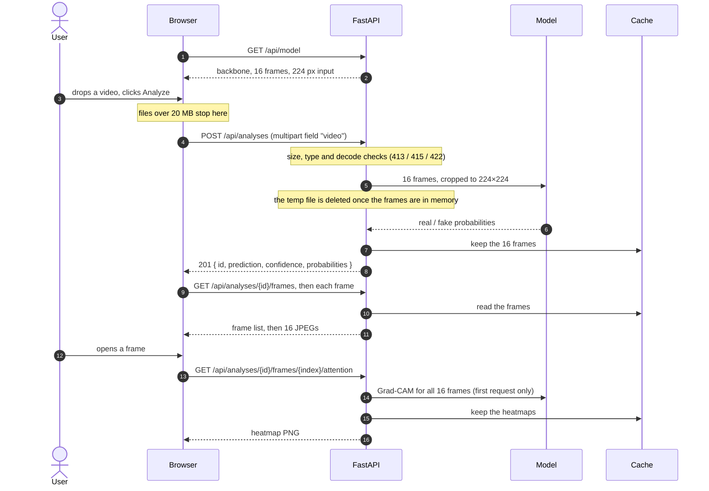
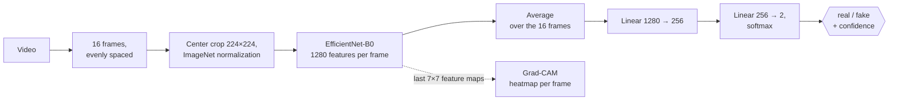

# RealVision Architecture

**Status:** Approved, 2026-10-06. All stages implemented (see §7).

RealVision is a platform around an existing, trained deepfake detection model. The work is on the backend and the platform, not on improving the model: the model's predictions must not change. The ML modules are treated as a behavioral baseline (see §5).

---

## 0. Scope and constraints

**In the MVP:** video upload, validation, prediction, confidence and probabilities, sampled frames, Grad-CAM, clear error handling, automated tests.

**Not in the MVP:** users, authentication, history, PostgreSQL, Redis, Docker.

**Fixed decisions:**

- The repository has two top-level folders, `frontend/` and `backend/`.
- Frontend: React + TypeScript + Vite.
- Backend: FastAPI only, on Python 3.11, managed with `uv` and `pyproject.toml`.
- The ML pipeline is fixed: 16-frame uniform sampling, preprocessing, model architecture, inference behavior and Grad-CAM. They change only if a compatibility issue forces it, and any change needs regression/parity validation.
- The upload limit is 20 MB, counted as 20 × 1024 × 1024 bytes on both the backend and the frontend.
- Grad-CAM is computed lazily.
- The in-memory analysis cache is used for the MVP only.
- Frames are fetched from their own endpoint, not returned inside the analysis response.
- **The app starts in a degraded state when the model checkpoint is unavailable** (see §2 and §4).

## 1. Architecture

```
┌──────────────────────────────┐        ┌──────────────────────────────────────────┐
│ frontend/                    │  /api  │ backend/  FastAPI · uvicorn · 1 process  │
│ React + TS + Vite            │ ─────► │                                          │
│ upload · verdict · frames ·  │        │ api/       routes, schemas, error mapping│
│ heatmap · pipeline view      │        │ services/  upload, validation, analysis  │
└──────────────────────────────┘        │ ml/        model, preprocess, Grad-CAM   │
  dev: Vite proxies /api → :8000        │            + predictor (lock)            │
  prod-like: FastAPI serves             │ storage/   in-memory analysis cache      │
  frontend/dist at "/"                  └──────────────────────────────────────────┘
```

- **Layer rule.** Only `api/` imports FastAPI. `services/`, `ml/` and `storage/` are plain Python, so tests can call them directly.
- **Model loading.** The app tries to load the model once, at startup. If the checkpoint is missing or fails to load, the app logs the reason and **keeps running in a degraded state**: endpoints that need the model return 503 `MODEL_UNAVAILABLE`, and `/api/health` reports the degraded state.
- **One model lock.** A single lock serializes inference and Grad-CAM. This prevents a race between them (Grad-CAM registers a forward hook on the shared model) and keeps the event loop free, because routes are plain sync `def` functions that run in the thread pool.
- **Single worker only.** The in-memory cache means the app must run with one uvicorn worker. This is a documented MVP limitation.

## 2. API contract

| Method & path | Success | Body | Needs the model |
|---|---|---|---|
| `POST /api/analyses` (multipart, field `video`) | **201** | `{ id, prediction: "real"\|"fake", confidence, probabilities: { real, fake } }` | Yes |
| `GET /api/analyses/{id}/frames` | 200 | `{ frames: [ { index, frameNumber, timestamp\|null } ] }` | No |
| `GET /api/analyses/{id}/frames/{index}` | 200 | `image/jpeg` | No |
| `GET /api/analyses/{id}/frames/{index}/attention` | 200 | `image/png` (computed the first time it's requested, then cached) | Yes |
| `GET /api/health` | 200 or 503 | `{ status: "ok", modelLoaded: true }` (200) or `{ status: "degraded", modelLoaded: false }` (503) | No |
| `GET /api/model` | 200 | `{ backbone, sampledFrames, inputSize, featureSize, embeddingSize, classes: ["real","fake"] }`, read from the loaded model and the preprocessing constants, not a hand-written copy | Yes |

- `id` must be a UUID and `index` an integer of 0 or more; FastAPI checks both as typed path parameters.
- JSON field names are camelCase.
- `POST /api/analyses` returns 201 without a `Location` header, because there is no `GET /api/analyses/{id}` (the analysis cache doesn't store probabilities).
- `/api/health` is a status endpoint, so even its 503 uses the health body above rather than the error format.
- When the model is unavailable, the analysis cache stays empty, so the frame endpoints return 404 naturally.

### Error format

Every error response, except `/api/health`, uses:

```json
{
  "error": {
    "code": "...",
    "message": "..."
  }
}
```

| Status | `code` | When |
|---|---|---|
| 400 | `INVALID_REQUEST` | `video` field missing, malformed UUID, index not a non-negative integer (replaces FastAPI's default 422) |
| 413 | `VIDEO_TOO_LARGE` | Over 20 MB, rejected from `Content-Length` before parsing or while copying the upload |
| 415 | `UNSUPPORTED_MEDIA_TYPE` | Declared type is not `video/*` |
| 422 | `UNREADABLE_VIDEO` | decord can't open the file, or it has 0 frames |
| 404 | `ANALYSIS_NOT_FOUND` | Unknown or expired id |
| 404 | `FRAME_NOT_FOUND` | Index out of range |
| 404 | `NOT_FOUND` | Unknown `/api/*` route |
| 405 | `METHOD_NOT_ALLOWED` | Known path, unsupported method (keeps the `Allow` header) |
| 503 | `MODEL_UNAVAILABLE` | `POST /api/analyses`, `.../attention` or `GET /api/model` while the model isn't loaded |
| 500 | `INTERNAL_ERROR` | Anything unexpected. The message is always generic; details are logged on the server only |

## 3. Target project structure

Files and directories appear as the implementation stages in §7 are completed.

```
realvision-deepfake-platform/
├── README.md
├── .gitignore
├── frontend/                       # React + TS + Vite client (see §5)
└── backend/
    ├── pyproject.toml              # runtime deps + dev group (pytest, httpx, ruff)
    ├── uv.lock
    ├── .python-version             # 3.11
    ├── models/                     # baseline_best.pt, gitignored, copied in by hand
    ├── app/
    │   ├── main.py                 # create_app(settings, predictor=None), startup, routers, static mount
    │   ├── config.py               # checkpoint path, device, 20 MB limit, cache size/TTL, temp dir, frontend dist path
    │   ├── errors.py               # domain errors with code + message (incl. ModelUnavailable)
    │   ├── api/
    │   │   ├── routes/ health.py · model.py · analyses.py
    │   │   ├── schemas.py          # Pydantic response models (camelCase aliases)
    │   │   ├── error_handlers.py   # domain + validation + 404 + catch-all → error format
    │   │   └── dependencies.py     # get_settings / get_predictor (raises MODEL_UNAVAILABLE) / get_cache
    │   ├── services/
    │   │   ├── upload.py           # chunked copy to one temp file, size cap, guaranteed delete
    │   │   ├── validation.py       # declared type, decodable, frame count > 0
    │   │   └── analysis.py         # preprocess → predict → cache; frames; lazy attention
    │   ├── ml/
    │   │   ├── model_arch.py       # behavioral baseline, unchanged
    │   │   ├── preprocess.py       # behavioral baseline, unchanged
    │   │   ├── gradcam.py          # behavioral baseline, unchanged
    │   │   └── predictor.py        # load(), predict(), explain(), one lock, model info
    │   └── storage/
    │       └── analysis_cache.py   # behavioral baseline, unchanged
    └── tests/
        ├── unit/                   # baseline module tests + upload, validation, predictor (random weights)
        ├── api/                    # TestClient + fake predictor: every endpoint, every error, degraded mode
        └── integration/            # real checkpoint; skipped if missing
```

## 4. Request flows

### An analysis at a glance



The verdict comes back before any frame or heatmap is requested, and Grad-CAM runs only if someone opens a frame.

### Startup

1. `create_app` reads the settings and tries to load the checkpoint into a `Predictor`.
2. If loading succeeds, the app is **ready**.
3. If the file is missing or loading fails, the reason is logged and the app is **degraded**: it still serves `/api/health`, the frontend, and the 503 `MODEL_UNAVAILABLE` errors.
4. Tests pass their own (fake) predictor to `create_app`, or none, to test degraded mode.

### Creating an analysis

1. The browser checks the file size against 20 MB, then sends `POST /api/analyses` with FormData.
2. If the model isn't loaded, the server returns 503 `MODEL_UNAVAILABLE`.
3. If `Content-Length` is over the limit, the server returns 413 `VIDEO_TOO_LARGE` before parsing the form.
4. A missing `video` field returns 400 `INVALID_REQUEST`. A declared type other than `video/*` returns 415.
5. `upload.py` copies the file to one temp file in chunks, re-checking the size (413). The temp file is deleted in every case, including errors.
6. `validation.py` checks that decord can open the file and that it has frames; otherwise 422 `UNREADABLE_VIDEO`.
7. `analysis.py` runs `preprocess_video`, then `predictor.predict` under the lock (softmax; `fake` only if its probability is higher), then `cache.add`, which returns the id.
8. The server responds 201 with `{ id, prediction, confidence, probabilities }`.

### Loading frames and heatmaps

Frames and heatmaps are served from the analysis cache:

- `GET /api/analyses/{id}/frames` returns the frame list from the cache.
- `GET .../frames/{i}` encodes the frame as a JPEG on each request.
- `GET .../frames/{i}/attention`:
  1. Returns 503 if the model isn't loaded.
  2. If no heatmaps are cached yet, `predictor.explain` runs under the lock (`compute_gradcam` for all 16 frames) and the result is cached.
  3. `heatmap_to_png` returns the PNG.

### Model info

- The frontend calls `GET /api/model` once at startup, instead of using hard-coded constants in `constants/model.ts`.
- If it gets a 503, the pipeline view shows that model details are unavailable, and uploads show the server's `MODEL_UNAVAILABLE` message.

## 5. Behavioral baseline

### Prediction pipeline



**Fixed modules.** `model_arch.py`, `preprocess.py`, `gradcam.py` and `analysis_cache.py`, with their unit tests, define the existing ML behavior. Their behavior is kept unchanged; since stage 8 they are linted and formatted like the rest of the code. Any change to them, to their pinned dependency versions, or to the prediction maths must keep `tests/integration/test_parity.py` green.

**Prediction maths (fixed).**

- Softmax over the two classifier logits; class order `real = 0`, `fake = 1`.
- The label is `fake` only if its probability is higher than `real`'s; a tie is `real`.
- `confidence` is the probability of the chosen label.
- Grad-CAM explains the predicted class.

**What `predictor.py` adds around it.**

- a configurable checkpoint path and device (default `cpu`);
- loading at startup that may fail without crashing the app;
- a lock around inference and Grad-CAM;
- `explain()` and model-info methods.

**Dependencies.** The ML dependency versions are pinned exactly (`==`) in `pyproject.toml`, so predictions can't drift with a library update.

**Frontend.** Stage 9 connected the client to this contract, keeping the existing components, views and styles:

- `api/client.ts`: checks the status before parsing, reads `error.message`, and falls back when an error body isn't JSON.
- `api/predict.ts` and `api/analysis.ts`: the paths in §2; `analysisId` became `id` in `types/prediction.ts`.
- `hooks/analysisReducer.ts`: a one-line change for the `id` rename.
- `hooks/useVideoAnalysis.ts`: the rename, and the 20 MB check before upload (it already owns errors, so it reuses `analysisFailed`; the limit is in `constants/upload.ts`).
- `constants/model.ts`: removed. `hooks/useModelInfo.ts` reads `/api/model` once; on a 503 the pipeline view says the model details are unavailable.
- `vite.config.ts`: proxy to `:8000`.
- Tests: new mocked responses, plus tests for the client, the size check, model info and a degraded server.

## 6. Main decisions and trade-offs

| Decision | Benefit | Cost |
|---|---|---|
| FastAPI only, serving the frontend build | One runtime, one hop, one contract, no CORS | Frontend and backend ship together |
| Baseline ML modules unchanged, plus **regression/parity validation** against a recorded behavioral baseline | Proves platform work didn't change predictions | Keeps existing choices such as decord, for now |
| Sync routes + one model lock | No event-loop blocking, no Grad-CAM race | One inference at a time |
| App factory + dependency injection + startup loading | API tests run without the checkpoint, using a fake predictor | A little more structure |
| **Degraded start without a checkpoint** | The app, frontend and health check stay up; the failure is visible and explicit (503 `MODEL_UNAVAILABLE`) | A misconfigured deploy can look "up", so anything that checks readiness must look at `/api/health`'s status, not just whether the process is running |
| Domain errors → one handler → one error format | All codes defined in one place; services stay framework-free | One more mapping layer |
| Validation by decoding, not only magic bytes | Catches corrupt files with a clear 422 | The whole file must be uploaded first |
| `Content-Length` precheck + cap during copy | Fast rejection; still enforced if the header lies | Starlette has already spooled the body by the time the route runs; no true streaming cap in the MVP |
| Lazy Grad-CAM, in-memory cache | Fast first response; no Redis | Single worker; lost on restart |
| `/api/model` read from the loaded model | Can't drift from the backend | One extra request at frontend startup; unavailable in degraded mode |
| 201 without a `Location` header | Correct "created" semantics | There's no `GET /api/analyses/{id}` |

## 7. Implementation order

Each stage ends with its tests green. All stages are completed.

1. **Repo bootstrap.** *(Completed.)* `backend/` with uv on Python 3.11, `pyproject.toml`, pytest + ruff running on an empty suite. `frontend/` in place and building.
2. **ML core.** *(Completed.)* Add the four baseline ML and storage modules and their tests, unchanged; the tests pass.
3. **Predictor.** *(Completed.)* Loading (success and failure), lock, `predict`, `explain` and model info. Unit tests use random weights; a real-checkpoint test is skipped if the file is missing.
4. **App foundation.** *(Completed.)* Config, `create_app`, ready and degraded startup, error format and handlers (400 for request-shape errors, 503 `MODEL_UNAVAILABLE`, generic 500), `GET /api/health` in both states, `GET /api/model`.
5. **Upload and validation services.** *(Completed.)* Size cap, type check, decode and frame-count checks, temp-file cleanup. Tested with tiny synthetic videos generated in fixtures.
6. **`POST /api/analyses`.** *(Completed.)* API tests with the fake predictor cover 201, every error and degraded mode.
7. **Frame endpoints.** *(Completed.)* Frames list, JPEG and attention PNG: 404s, typed parameters, heatmaps computed once, 503 for attention in degraded mode.
8. **Integration and regression/parity validation.** *(Completed.)* Real checkpoint and real decode. Predictions on local sample videos are compared, within a tolerance, against a recorded behavioral baseline: the expected probabilities are generated locally once and stored as test fixtures. The sample videos stay local, so the test is skipped when they are missing. The baseline is recorded from V1's own inference code by `backend/scripts/record_baseline.py`; V2 matched it exactly (difference 0) on 6 FaceForensics++ clips.
9. **Frontend.** *(Completed.)* The paths in §2, the error format, `id`, `/api/model` with a 503 fallback, size check, Vite proxy, updated Vitest mocks.
10. **Production serving and README.** *(Completed.)* FastAPI mounts `frontend/dist` if it exists; manual smoke test in both ready and degraded states; run instructions.

## 8. Resolved decisions

1. **Request-shape errors:** 400 `INVALID_REQUEST` instead of FastAPI's default 422; 422 is kept for `UNREADABLE_VIDEO` only.
2. **Startup without a checkpoint:** the app starts **degraded**. Health returns 503 `{ status: "degraded", modelLoaded: false }`; endpoints that need the model return 503 `MODEL_UNAVAILABLE`.
3. **`POST /api/analyses` response:** 201, no `Location` header, field `id`.
4. **Validation policy:** declared `video/*` + decord decode + frame count > 0. No separate magic-byte library and no container allowlist; the UI hint keeps saying "MP4, MOV".
5. **`/api/model` fields:** the six fields in §2, all derived at runtime. The code has no source for training metrics, and none were available, so the README says accuracy is not documented.
6. **Frames:** a separate endpoint, not part of the analysis response.

## 9. Defaults that can still change

- `opencv-python-headless` instead of `opencv-python` (same functions, no GUI).
- torch from the default PyPI wheels (fine for local Windows CPU); a CPU-only index only matters later for Linux or CI.
- Keep the `torchvision` and `Pillow` pins for compatibility with timm.
- Frontend types hand-written for the MVP; generating them from OpenAPI can come later.
- Test videos synthetic, generated by OpenCV in fixtures. FaceForensics++ samples stay local and are used only by the regression/parity test.
- npm for the frontend, ruff for Python linting, no type checker in the MVP.
- Frame image URLs built by the client.
